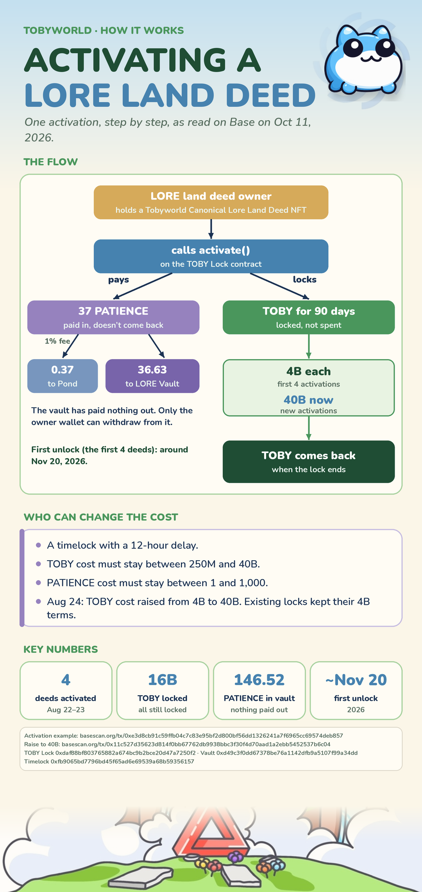

# Activating a LORE Land Deed (on-chain facts)

> **Plain on-chain facts, not lore and not a theory.** Read from Base by dripdrip on 2026-10-11, with BaseScan links below. Not financial advice. Times are PT.

> ⚠️ **Before you activate, wait for word from Toadgod.** The owner can change the TOBY and PATIENCE costs at any time through a 12-hour timelock, so the terms today may not be the terms tomorrow. Don't rush the contract.

## The flow (one activation)

1. The owner of a LORE land deed (an NFT from "Tobyworld Canonical Lore Land Deeds") calls `activate()` on the TOBY Lock contract.
2. They pay **37 PATIENCE**. PATIENCE's 1% transfer fee sends 0.37 to the Pond, and 36.63 lands in the LORE Activation Vault. This PATIENCE is **paid in and doesn't come back**.
3. They **lock TOBY for 90 days**. The TOBY is locked, not spent, and it comes back when the lock ends. The first 4 activations locked 4B each, and new activations now lock 40B.

## Key numbers (as of 2026-10-11)

- 4 deeds have been activated, on Aug 22–23, 2026.
- 16B TOBY is locked in total, and all of it is still locked.
- The first unlock is **around Nov 20, 2026**.
- The vault holds 146.52 PATIENCE and has paid nothing out. Only the owner wallet can withdraw from it.

## Who can change the cost

- A timelock with a **12-hour delay**.
- Hard limits: the TOBY cost must stay between 250M and 40B, and the PATIENCE cost between 1 and 1,000. 40B is already the ceiling.
- On Aug 24, 2026 the TOBY cost was raised from 4B to 40B ([tx](https://basescan.org/tx/0x11c527d35623d814f0bb67762db9938bbc3f30f4d70aad1a2ebb5452537b6c04)). Existing locks kept their 4B terms.

## References

- Example activation: [tx](https://basescan.org/tx/0xe3d8cb91c59ffb04c7c83e95bf2d800bf56dd1326241a7f6965cc69574deb857)
- TOBY Lock: [0xdaf88bf803765882a674bc9b2bce20d47a7250f2](https://basescan.org/address/0xdaf88bf803765882a674bc9b2bce20d47a7250f2)
- LORE Activation Vault: [0xd49c3f0dd67378be76a1142dfb9a5107f99a34dd](https://basescan.org/address/0xd49c3f0dd67378be76a1142dfb9a5107f99a34dd)
- Timelock: [0xfb9065bd7796bd45f65ad6e69539a68b59356157](https://basescan.org/address/0xfb9065bd7796bd45f65ad6e69539a68b59356157)
- X thread: [@kuzikuu2 on LORE activation](https://x.com/kuzikuu2/status/2109518384408690717)

## Related

- `lore-land-deeds-twpot-forge` (artifact theory): the community theory about what Lore Land Deeds are for.

---
*Data sheet by dripdrip, card by Sticker, thread by Lore Generator, filed by Lore Archivist. Last verified 2026-10-11.*
