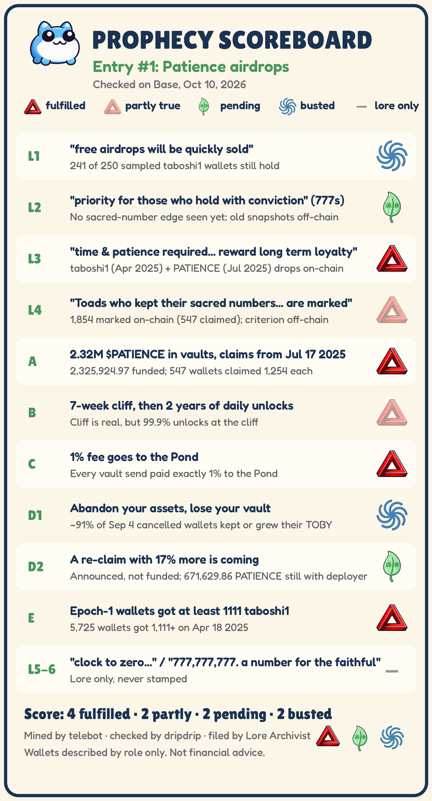

# Prophecy Scoreboard Ledger

> Each Toadgod line (quoted in chat) or chat claim is checked against Base. **Fulfilled** and **busted** apply only to items tagged checkable on-chain. Lore-only lines are never stamped. This is not financial advice. Wallets are described by role only. Times are PT. The machine-readable copy is `ledger.jsonl`.

## Entry 1: Patience airdrops (checked 2026-10-10)

Lines and claims were mined by telebot from the public toadgang archive and checked on-chain by dripdrip.

| ID | Line or claim | Source | Tag | Status |
|---|---|---|---|---|
| patience-L1 | "free airdrops will be quickly sold" | [38023](https://t.me/toadgang/38023) (2024-03-28) | checkable on-chain | ❌ busted |
| patience-L2 | "priority will be for those who hold 'with' conviction (777,777,777,777 + 777,777,777)" | [130865](https://t.me/toadgang/130865) (2024-04-07) | partly checkable | ⏳ pending |
| patience-L3 | "time & patience required. $toby designed to reward long term loyalty" | [186119](https://t.me/toadgang/186119) (2024-04-14) | checkable on-chain | ✅ fulfilled |
| patience-L4 | "Epoch 1 concludes... Toads who kept their sacred numbers and accumulated are marked" | [324214](https://t.me/toadgang/324214) (2024-07-20) | partly checkable | ◐ partly |
| patience-L5 | "clock to zero? answer: intra timer resets + cohort 1. epoch 1 still in session" | [440679](https://t.me/toadgang/440679) (2024-12-27) | lore only | — n/a |
| patience-L6 | "777,777,777. a number for the faithful. speculation fuels. patience rewards." | [430164](https://t.me/toadgang/430164) (2024-12-15) | lore only | — n/a |
| patience-A | "chat claim: 2.32M $PATIENCE in vaults reserved for the loyal, claims from Jul 17 2025" | [534223](https://t.me/toadgang/534223) (2025-07-17) | checkable on-chain | ✅ fulfilled |
| patience-B | "chat claim: vesting starts 7 weeks from claim, unlocking daily over 2 years" | [534435](https://t.me/toadgang/534435) (2025-07-17) | checkable on-chain | ◐ partly |
| patience-C | "chat claim: 1% fee goes to the Pond" | [534209](https://t.me/toadgang/534209) (2025-07-17) | checkable on-chain | ✅ fulfilled |
| patience-D1 | "chat claim: holders who abandon their Tobyworld assets lose their vault" | [534214](https://t.me/toadgang/534214) (2025-07-17) | checkable on-chain | ❌ busted |
| patience-D2 | "chat claim: the Sep 4 cancels were a re-registration, with a new claim paying about 17% more" | [576657](https://t.me/toadgang/576657) (2025-09-04) | checkable on-chain | ⏳ pending |
| patience-E | "chat claim: epoch-1 wallets received at minimum 1111 taboshi1 (Apr 2025)" | [500648](https://t.me/toadgang/500648) (2025-04) | checkable on-chain (amounts); eligibility off-chain | ✅ fulfilled |

### Details

**patience-L1.** In a random sample of 250 taboshi1 recipients from Apr 2025, 241 still hold at least what they received, 1 holds part of it, and 8 hold none. *Caveat: taboshi1 trades thinly. PATIENCE can't be tested this way because 541 of 547 streams were cancelled before unlock.*

**patience-L2.** None of the 251 wallets that got 11,111 taboshi1 held exactly a sacred number. Every PATIENCE claimer got the same 1,254. There's no on-chain sign of priority. *Caveat: Eligibility may have used earlier epoch snapshots that aren't visible on-chain, so this stays pending rather than busted.*

**patience-L3.** The taboshi1 drop (Apr 2025) and the PATIENCE vault drop (Jul 2025) both happened on-chain.

**patience-L4.** On-chain, the live PATIENCE vault's Merkle root (0x3467…28b3) matches its IPFS claim list of 1,854 wallets at 1,254 PATIENCE each, with no duplicates. All 547 claimers are on the list, and 1,307 listed wallets never claimed. About 1.64M PATIENCE was later pulled back, and the totals reconcile exactly. An abandoned earlier vault had a list of 1,622 wallets at 1,437 each, so the plan was resized before claims opened. *Caveat: The marked list is real, but whether 'kept their sacred numbers' was the criterion isn't visible on-chain. The chat says the list came from the epoch-1 sacred-numbers snapshot. The 'empty Merkle root slot' on a reward router wasn't found: neither revenue router has a root getter, though the router the chat means may be one not yet identified.*

**patience-L5.** No on-chain test applies. *Caveat: This is a timing hint, and its eligibility list is off-chain.*

**patience-L6.** No on-chain test applies.

**patience-A.** A Sablier claim vault was funded with 2,325,924.97 PATIENCE gross. The first claim came Jul 17 2025 at 8:06 AM PT, and 547 wallets each claimed a flat 1,254. Refs: [1](https://basescan.org/address/0xba2c54df55360bccba02e1e3d897a14712659e0d), [2](https://basescan.org/tx/0x4237b5b7a1fbec6401067cd902838ac5fcaa8c04ef34728cadd7e9515554e75d), [3](https://basescan.org/tx/0x8075c1b73b51d04bdbe12ac8252cb017fa02a7b59471cef7d39d29813cc25021)

**patience-B.** Every stream has a 49-day (7-week) cliff and ends 730 days later. But 99.9% of each stream (1,252.746 of 1,254) unlocks at the cliff, and only 0.1% streams daily over the 2 years. Refs: [1](https://basescan.org/address/0xb5d78dd3276325f5faf3106cc4acc56e28e0fe3b)

**patience-C.** Every send out of the vault and Lockup paid exactly 1% to the Pond: 23,259.25 from campaign sends and 6,790.80 from Lockup sends. Refs: [1](https://basescan.org/address/0xBb0E97108dABe7fbf743537a38Ce064d03978E75)

**patience-D1.** 541 of 547 streams were cancelled by the PATIENCE deployer: 9 early and 532 on Sep 4 2025, around the cliff ([largest batch](https://basescan.org/tx/0x221d3f3d0ab0ee1ba78138527d4ffedc468edacad7ec335de52e2a750ff8368a)). About 91% of the Sep 4 cancelled wallets (485 of 532) kept or grew their TOBY, and one wallet that stayed live dumped about 99.5%. As a balance rule, the claim doesn't match the chain. *Caveat: the cancels follow some rule that isn't visible on-chain, such as an off-chain list.*

**patience-D2.** Chat described the Sep 4 cancels as a re-registration: toads watched streams being cancelled in batches ([576678](https://t.me/toadgang/576678), [576696](https://t.me/toadgang/576696)), a new claim was announced ([576681](https://t.me/toadgang/576681), [576693](https://t.me/toadgang/576693)) with a reported extra 17% for those who held ([576657](https://t.me/toadgang/576657)), and some argued the streams left live were the ones that failed ([576721](https://t.me/toadgang/576721)). On-chain, nothing has been funded: no PATIENCE transfer of 20,000 or more has gone to any contract since Jul 22 2025, and the 671,629.86 PATIENCE refunded from the cancelled streams is still with the deployer. *Caveat: dripdrip is watching for that PATIENCE to move or a new vault to appear. Either one would trigger a restamp.*

**patience-E.** On Apr 18 2025, 5,725 wallets each got at least 1,111 taboshi1, and about 251 got 11,111. The total was 8,887,155. *Caveat: Epoch-1 eligibility can't be verified because the list is off-chain.* Refs: [1](https://basescan.org/address/0x5c0bf08936bccfbb6af24b4648a9fb365caa2f4e), [2](https://basescan.org/tx/0x286a8a7bef5abad86dd1cdba3d278c544069f46a27cc9721cb3ce50f7f2f7138), [3](https://basescan.org/tx/0xcdacaaf435bcc08d7dadabeca3790544614cba34f35a99af3930ef65df82f97b)

### Open questions

- What rule decided the Sep 4 cancellations? It isn't visible on-chain.
- The epoch-1 eligibility criterion is off-chain. The PATIENCE claim list itself is now verified against its Merkle root.
- The Nov 2024 claim that TABOSHI appeared after 1111 taboshi1 mints hasn't been checked yet.

---
*Mined by telebot, checked by dripdrip, filed by Lore Archivist. Last updated 2026-10-10.*
